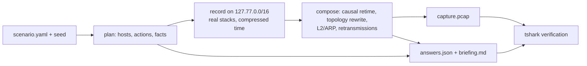

# pcapforge

[](https://github.com/j3k01/PcapForge/actions/workflows/ci.yml)
[](https://github.com/j3k01/PcapForge/releases)
[](LICENSE)
[](scenarios/LICENSE)
[](pyproject.toml)

Generate realistic, labeled packet captures with answer keys for blue-team, SOC and
detection-engineering training.

Pick a scenario, a difficulty and a seed. pcapforge records **real protocol stacks** (OS
TCP/IP, pymodbus, asyncua OPC UA, S7comm, DNS, NTP, DHCP) talking to each other on loopback addresses,
composes the traffic into a believable site topology, and writes:

- `capture.pcap` / `capture.pcapng`: decodes cleanly in Wireshark, tshark, Zeek, Suricata and Splunk Stream
- `answers.json`: IOCs, timeline with frame numbers, MITRE ATT&CK (Enterprise/ICS) mapping, questions with answers and the tshark filter that proves each answer
- `briefing.md`: the student handout (scenario text, asset inventory, register map, questions without answers)
- `submission_template.yaml`: the questions as a blank answer sheet for `pcapforge grade`
- with `--siem`: `siem/*.jsonl` logs for Splunk/Elastic and `detections/` (Suricata rules, Sigma rules, hunting guide)
- with `--zeek`: `zeek/*.log`, real Zeek logs of the capture (JSON)

The same seed always gives the same exercise, and every student can get their own variant.
Ready-made student and instructor packs are on the [releases page](https://github.com/j3k01/PcapForge/releases).

> **Defensive by design.** The repository contains no malware, implants, exploit code or
> working payloads. Every "suspicious" behaviour is produced by benign clients and
> services that follow the behavioural pattern an analyst needs to recognise.
> Contributions that need weaponised code are out of scope; see [CONTRIBUTING.md](CONTRIBUTING.md#defensive-policy).

## Quick start

Requirements:
- Python 3.13
- Wireshark 4.4 or newer (`tshark` and `dumpcap`); Ubuntu 24.04 ships 4.2, so add `ppa:wireshark-dev/stable` there
- loopback capture rights:
  - Windows: Npcap with *loopback support*, the Wireshark installer default
  - Linux: none when pcapforge runs in its own user and network namespace (`unshare -rn pcapforge ...`, see
    [platform notes](docs/how-it-works.md#platform-notes)), otherwise `sudo setcap cap_net_raw,cap_net_admin=eip $(which dumpcap)`
    plus, once per boot, `sudo ip route add local 127.77.0.0/16 dev lo table local quickack 1`

```console
$ pip install -e .                # medium/hard of the OT scenarios also need: pip install -e .[opcua,s7]
$ pcapforge list
...
ot-modbus-write-manipulation  OT  easy/medium/hard  T0855,T0836     Unauthorized Modbus/TCP setpoint changes on a process PLC

$ pcapforge generate --scenario ot-modbus-write-manipulation --difficulty easy --seed 42
  [42] plan: 4020 actions, recording key 088575127c99cf5e0fbfc8c4
  [42] recording: captured
  [42] composed 13751 packets
out/ot-modbus-write-manipulation_easy_42/capture.pcap  (13751 packets, verified)
```

A class of 25 students, each with a unique variant, or one variant per login, or a Polish handout
(also `--lang de`):

```console
$ pcapforge generate -s ot-modbus-write-manipulation -d hard --seed course-2026 --count 25
$ pcapforge generate -s ot-modbus-write-manipulation -d medium --seeds-file students.txt
$ pcapforge generate -s ot-modbus-write-manipulation -d easy --seed 42 --lang pl
```

### What the analyst sees (easy, seed 42)

```console
$ tshark -r capture.pcap -Y "modbus.func_code in {6, 43} && !modbus.request_frame" \
    -T fields -e frame.time_utc -e eth.src -e ip.src -e ip.dst -e modbus.func_code -e modbus.reference_num -e modbus.regval_uint16
2025-03-22T11:45:33.663741Z  b8:27:eb:23:26:6d  10.241.35.219  10.241.35.159  43
2025-03-22T11:45:36.016219Z  b8:27:eb:23:26:6d  10.241.35.219  10.241.35.159  6  8  1587
2025-03-22T11:45:37.918517Z  b8:27:eb:23:26:6d  10.241.35.219  10.241.35.159  6  4  635
...
```

And the matching entry in `answers.json`:

```json
{
  "id": "first_write",
  "text": "At what time (UTC) was the first unauthorized write request sent?",
  "type": "timestamp",
  "answer": "2025-03-22T11:45:36.016219Z",
  "tolerance_s": 1,
  "checks": [{"filter": "frame.number == 7209 && modbus.func_code in {5, 6, 15, 16} && ip.src == 10.241.35.219",
              "expect": {"count": 1}}]
}
```

## Commands

| command | what it does |
|---|---|
| `pcapforge generate` | plan, record, compose and verify one run (or a batch of seeds) |
| `pcapforge list` / `show <scenario>` / `validate` | list scenarios, describe one, check scenario files |
| `pcapforge verify capture.pcap -a answers.json` | re-check a capture against its answer key |
| `pcapforge export <run dir> [--zeek]` | (re)create the [SIEM logs, detections and Zeek logs](docs/siem.md) |
| `pcapforge package <run dir>` | student zip and instructor zip ([grading and packaging](docs/grading.md)) |
| `pcapforge grade answers.json <submissions>` | score YAML or CSV submissions, per question and per class |
| `pcapforge report <run dir>` | self-contained `report.html` for the debrief, with process charts |
| `pcapforge export-ctfd <run dir>` | one CTFd challenge per question (`ctfcli` format) |
| `pcapforge ui [--student]` | local [web UI](docs/web-ui.md) for instructors, or the student side with answer forms |

`pcapforge <command> --help` lists every option; the documentation site has the same as a CLI reference.

## Scenarios

| id | techniques | what happens |
|---|---|---|
| `ot-modbus-write-manipulation` | T0855, T0836 (+T0888, T0861 with discovery) | A host outside the approved change path writes setpoints outside their normal band. |
| `ot-modbus-discovery` | T0846, T0888, T0861 | A port-502 sweep, device identification and register-map enumeration; nothing is written. |
| `ot-modbus-command-replay` | T0855, T0831 | An unapproved host re-sends operator commands off-cycle; every value is in band. |
| `ot-modbus-coil-manipulation` | T0855, T0831 (+T0878 with ack) | Coil writes force actuators out of their normal state; medium/hard also acknowledge the alarm. |
| `ot-modbus-alarm-masking` | T0878, T0836, T0855 | An alarm threshold is moved out of band first, then the setpoint it was guarding. |
| `ot-iec104-command-injection` | T0855, T0831 | An unapproved host opens feeder breakers on a substation RTU over IEC 60870-5-104. |
| `ot-bacnet-unauthorized-write` | T0855, T0836 | An unapproved host overrides building-controller setpoints with BACnet WriteProperty at high priority. |
| `ot-dnp3-control-injection` | T0855, T0831 | An unapproved host latches actuators off on a water/wastewater outstation with DNP3 control-relay commands. |
| `ot-enip-drive-manipulation` | T0855, T0831 | An unapproved host opens an EtherNet/IP I/O connection to a PowerFlex drive and forces its speed reference. |
| `ot-baseline-operations` | none | Normal operations only, for baselining and false-positive tuning. |
| `it-baseline-operations` | none | An office LAN as the working day starts: Windows Server DHCP behind the firewall's relay, PCs that boot and confirm their leases, a new PC's first lease, intranet HTTPS, Windows Update against WSUS. |
| `it-dns-tunneling` | T1071.004, T1048.003 | One office PC sends a run of DNS queries with long base32 labels under one fictional parent domain through the DC resolver (benign; the resolver forwards and SERVFAILs). |
| `it-https-beaconing` | T1071.001, T1573 | One office PC checks in over HTTPS to an external-looking service at a regular interval (benign: a TLS client fetching a small static page from a local test server through the firewall); the tell is a rare destination on a conspicuously regular cadence. |
| `it-volumetric-flood` | T1498, T1498.001 | One or more office PCs send a bounded high-rate burst of UDP datagrams to a local collector's sink service (benign Discard on port 9); no amplification or spoofing. |
| `it-bulk-upload` | T1048, T1567 | One office PC uploads a large amount of opaque data to a fictional external cloud file host through the firewall (benign exfiltration equivalent): a plain-HTTP POST (easy) or HTTPS uploads whose tell is the outbound/inbound byte ratio (medium/hard). |
| `it-scan-auth-failures` | T1046, T1110, T1110.001, T1110.003 | An unmanaged office host TCP-scans the server subnet for common IT ports (open vs filtered), then drives Kerberos AS pre-authentication failures (KDC_ERR_PREAUTH_FAILED) at the domain controller — brute force on one account (easy) or password spraying across many (medium/hard), with one successful guess on hard. |
| `it-ot-pivot` | T1046, T0886, T0846, T0855, T0836 | An office workstation routes through the IT/OT firewall into the control network, sweeps it for Modbus/TCP (port 502), identifies the PLCs and writes a setpoint out of band — the first scenario spanning the IT and OT lines. easy/medium are captured on the office switch; on hard the sensor is on the OT side and the office host's frames arrive routed, carrying the firewall's MAC. |
| `it-ot-baseline-operations` | none | A combined IT and OT site with an industrial DMZ, no incident: the office LAN, a DMZ (jump host, replica historian) and the plant control network on one firewall. The legitimate cross-zone traffic is the baseline: the plant historian replicates to the DMZ replica over HTTPS on a fixed schedule, an office engineer RDPs to the DMZ jump host and the jump host RDPs to the engineering workstation (cleartext `mstshash` cookie, then TLS), and the control network takes its time from the DMZ. easy/medium are captured on the DMZ switch, hard on the control-network switch. |
| `it-rogue-dhcp` | T1557, T1557.003 | An unauthorised DHCP server (dnsmasq on a Raspberry Pi) answers clients on the office segment before the firewall-relayed Windows Server Offer arrives, so hosts that join take its lease and come up with the rogue's own default gateway and DNS resolver; easy is obvious (a Raspberry Pi OUI and a wrong subnet mask, several new PCs), medium blends in (only router/DNS differ, a few lookups at the rogue resolver), hard appears late and affects a single host with a very short lease. |
| `it-kerberoasting` | T1558.003 | A signed-in domain user on a managed office workstation requests Kerberos service tickets (TGS-REQ) for many service accounts' SPNs in a burst, asking for RC4-HMAC (etype 23) where Windows clients request AES, so the KDC returns RC4-encrypted service tickets an attacker would crack offline (benign: correct Kerberos on the loopback, opaque ticket bytes, nothing cracked). easy requests many SPNs in seconds, RC4 only; medium fewer, interleaved with legitimate AES tickets; hard low-and-slow across the capture with the user also doing normal domain work. |
| `it-smb-lateral-movement` | T1021.002, T1078.002, T1083 | One host authenticates with a single domain account and opens the administrative shares (ADMIN$, IPC$, C$) of many office workstations over SMB, after a `cifs/<workstation>` Kerberos ticket for each, listing the share (benign: no service install or remote execution). easy reaches every workstation in a minute from an uninventoried host; medium a subset buried in the SYSVOL Group Policy traffic; hard a handful over two hours from a legitimate admin workstation, one of which refuses the ADMIN$ connection (access denied). |
| `it-ldap-reconnaissance` | T1087.002, T1069.002, T1482 | A host that is not a normal directory client binds to the domain controller over LDAP and enumerates the Active Directory — all users, the accounts with a service principal name, the protected (adminCount=1) accounts, the Domain Admins membership and the domain trusts. easy/medium bind unsealed so the filters and returned entries are readable (medium pages the results and spreads them out); hard binds with Kerberos (GSS-SPNEGO, sealed) exactly like a member, so the tell is volume and timing — one host opening round after round of LDAP sessions, each pulling large sealed responses. |

Every scenario has easy, medium and hard. In `ot-modbus-write-manipulation`, easy is 15 minutes with two
PLCs and a rogue Raspberry Pi; hard is 2 hours with 3 to 5 Modbus PLCs, an S7-1500, OPC UA, a telecontrol
outstation (IEC 104, DNP3 or BACnet/IP), EtherNet/IP, Windows and IPv6 background traffic, and the writes come
from the legitimate engineering workstation. Level tables, languages, actor types, process profiles and how
to write a scenario: [docs/scenarios.md](docs/scenarios.md).

## How it works



PLCs run a physical-process model, so a written setpoint visibly drives the measurements and alarms that
follow it. Every answer resolves to frames and is checked with tshark before the run is written. Details,
reproducibility and long captures (24 h works): [docs/how-it-works.md](docs/how-it-works.md).

## Documentation

- [Web UI](docs/web-ui.md): generation, run pages, downloads, student mode and access codes
- [Grading and packaging](docs/grading.md): handouts, scoring rules, CTFd, debrief report
- [SIEM export and detections](docs/siem.md): JSON-lines datasets, Suricata and Sigma rules, Zeek logs
- [Scenarios](docs/scenarios.md): scenario and level tables, actor types, process profiles, writing a scenario
- [How it works](docs/how-it-works.md): pipeline, reproducibility, long captures, tests, platform notes
- [CHANGELOG.md](CHANGELOG.md), [CONTRIBUTING.md](CONTRIBUTING.md), [ROADMAP.md](ROADMAP.md), [design notes](docs/DESIGN.md)

The documentation site (these pages plus reference pages generated from the code: CLI, actor types,
device and process profiles, scenario schema, answers.json keys) builds with MkDocs:
`pip install -e .[docs]` then `mkdocs build --strict` (or `mkdocs serve`).

## Development

```console
$ pip install -e .[test,opcua,s7]
$ pytest
```

The end-to-end tests record real traffic and are skipped without tshark 4.4+ and capture rights. See
[CONTRIBUTING.md](CONTRIBUTING.md) for the setup on Windows and Linux and the pull request checklist.

## License

Code: [Apache-2.0](LICENSE). Scenarios and profiles: [CC-BY-4.0](scenarios/LICENSE).
