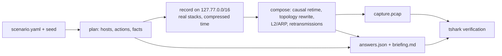

# How it works



1. **Plan.** The seed decides the site (name, domain, devices), the actions on a virtual timeline, and the facts the answer key is built from.
2. **Record.** Each host gets its own loopback address. pymodbus PLCs run a physical-process model (see [Process profiles](scenarios.md#process-profiles)), so polled values evolve over the virtual timeline, and a written setpoint visibly drives the measurements and alarms that follow it. OPC UA tags of a SCADA server and S7 data blocks read the same models. Clients run back-to-back, which captures hours of activity in seconds; payload timestamps (NTP, OPC UA) come from the virtual clock. A UDP marker before each action ties packets to actions. Recordings are cached by plan hash.
3. **Compose.** Packets keep their recorded order and bytes. Timing is rebuilt causally from device profiles: per-host link latency, PLC processing time, the OS delayed-ACK behaviour and retransmission timeouts. The rest of the realism layer:
   - IP/MAC/port rewrite with ephemeral ports per OS
   - ISN remap, TTL by OS minus routed hops, IP-ID behaviour per OS
   - TCP options and window per OS, recomputed checksums
   - DNS A records mapped to the final topology
   - multicast and broadcast discovery traffic gets its group or subnet broadcast address, the matching Ethernet group MAC and the sender OS's TTL, and is seen only from hosts on the sensor segment
   - only packets visible from the SPAN port are kept
   - routed traffic carries the gateway MAC
   - ARP is synthesized
4. **Answer key and verification.** Facts resolve to frames and timestamps. tshark checks:
   - no malformed frames, bad checksums or expert errors
   - no loopback addresses leak (127.0.0.0/8, ::1)
   - every question's filter matches the capture

## Reproducibility

- Same `--seed` gives the same plan and the same `answers.json`. With a cached recording, the capture is byte-identical too.
- A live re-recording on another machine gives the same answers. The capture can differ only in low-level stack details.
- On medium and hard the seed also draws the story structure: the physical process (four profiles, each with its own register map, units and physical effects) and the number of PLCs. Scenario authors get this through `vars` values `{choose: [...]}` and `{range: [lo, hi]}`.
- `--base-seed` shares one recording between many `--seed`s. Students then get different IPs, MACs, ports and timing jitter on the same story. Without it, every seed is a fully independent variant.

## Long captures

`--duration` takes any length (`24h` works). The composer, the verification and the SIEM export
stream through the capture with a window of a few minutes, so memory does not grow with the
capture; what stays is the plan itself (about 0.15 KB per action). Measured on
`ot-baseline-operations` hard in WSL 2 (Ryzen 7 7700, cached recording for the later stages):

| duration | actions | packets | capture | record | compose | verify | export | peak RSS |
|---|---|---|---|---|---|---|---|---|
| 2 h | 0.27 M | 1.05 M | 116 MB | 2.2 min | 15 s | 20 s | 30 s | 0.19 GB |
| 6 h | 0.82 M | 3.15 M | 348 MB | 6.7 min | 46 s | 64 s | 95 s | 0.33 GB |
| 24 h | 3.27 M | 12.6 M | 1.4 GB | 23 min | 3.1 min | 4.6 min | 6.9 min | 0.93 GB |

Recording time grows linearly (about 2,000-2,300 actions per second, no capture drops). Before
streaming, composing alone peaked at 1.3 GB (2 h) and 3.5 GB (6 h), and 24 h ran out of a 13 GB limit.

## What the tests check

The end-to-end tests record real traffic, so they need tshark 4.4+, dumpcap (or tcpdump) and loopback capture rights; they are skipped otherwise. Medium and hard also need the `opcua` and `s7` extras. `tests/test_grade.py` (grading rules, the student zip holds no answer material) needs neither. The end-to-end tests check that:
- every capture passes the tshark integrity checks and all answer-key filters;
- every write in the key points at a frame with the right source, target, function, register and value;
- Scapy recomputes the same checksums;
- the same seed gives byte-identical output;
- `siem/modbus.jsonl` flags exactly the incident writes as out of band and the operator writes as in band, and `siem/flows.jsonl` accounts for every IP packet and byte;
- with `suricata` on PATH (CI installs it), the generated rules alert on every incident write and on no operator write, and the unapproved-writer rule fires on easy/medium but not hard;
- OPC UA runs only between the historian and the SCADA server (medium/hard: mid-session Publish and watchdog Read; easy: none), every message fits one Ethernet segment, every payload timestamp is on the scenario clock and the published tag values follow the process model (`tests/test_opcua.py`, which also records a full session from Hello to subscriptions and secure-channel renewals);
- S7comm sessions decode and their data blocks mirror the process (`tests/test_s7.py`);
- recording without an optional extra stops before capturing, with the install command.

## Platform notes

Wireshark 4.2 and older (the Ubuntu 24.04 package) do not decode the value of a Write Single Register
(function 6): students see it only as raw `modbus.data` bytes (`06:33` = 1587), and `modbus.regval_uint16`
and the answer-key filters that use it match nothing. pcapforge itself needs 4.4+ to verify a capture.

- **Windows:** Npcap's `\Device\NPF_Loopback` adapter is used; administrator rights are not needed.
- **Linux:** recording uses `lo`. Docker is not required. Linux delays loopback ACKs and piggybacks them on
  the next segment; before recording, pcapforge adds a `quickack 1` route for `127.77.0.0/16` so every
  segment is acknowledged at once, as on Windows, and the composer models each device's delayed ACK.
  Without it a Linux capture would lose most pure ACKs (easy: ~8k instead of ~14k packets). The rootless
  way needs neither sudo nor setcap:

  ```console
  $ unshare -rn pcapforge generate -s ot-modbus-write-manipulation -d easy --seed 42
  $ unshare -rn pytest
  ```

  `unshare -rn` runs the command as root of a new user and network namespace with its own `lo`:
  dumpcap/tcpdump can capture it, and pcapforge brings it up and adds the route there. Both disappear when
  the command exits. This needs unprivileged user namespaces (WSL 2 and most distributions allow them;
  Ubuntu 23.10+ can restrict them with AppArmor, `kernel.apparmor_restrict_unprivileged_userns`). Without a
  namespace, give dumpcap capture rights and add the route once per boot (see [Quick start](../README.md#quick-start)). tshark warns
  about running as root inside the namespace; the warning is harmless.
- **macOS:** add loopback aliases for `127.77.0.0/16` first.
